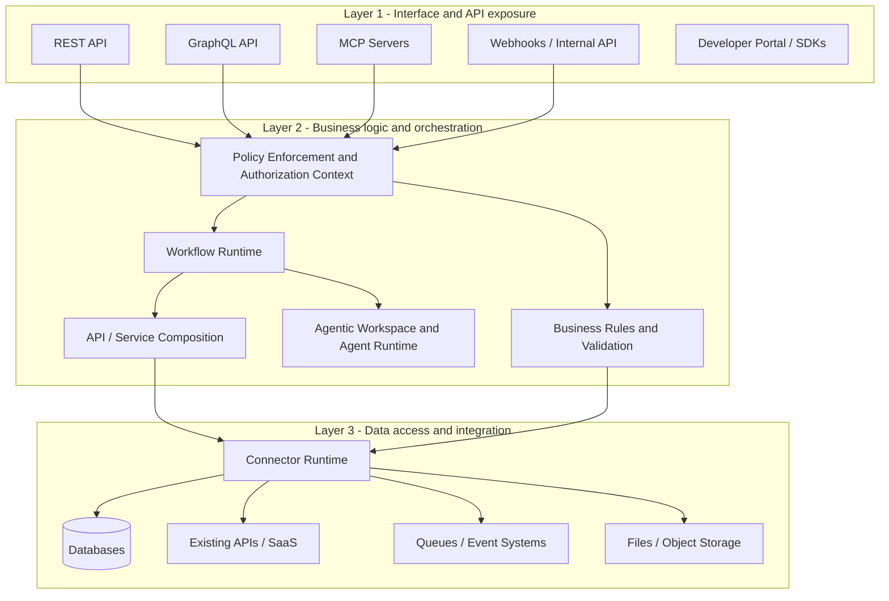
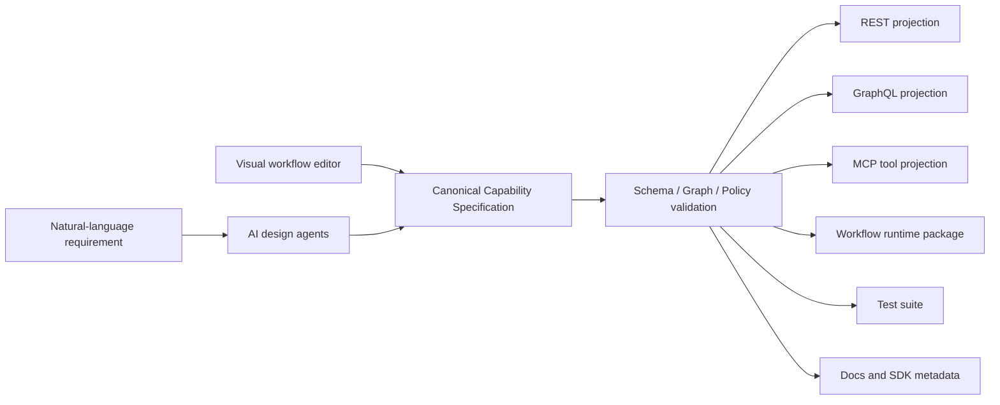
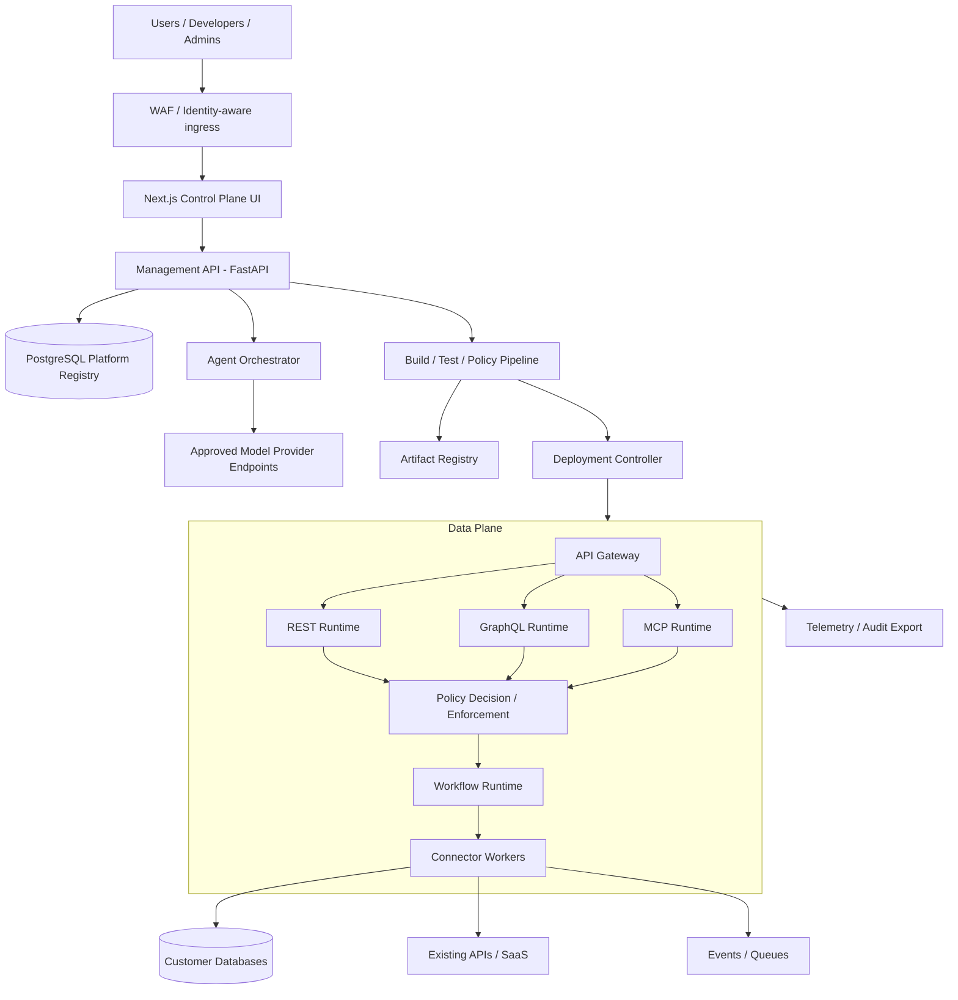
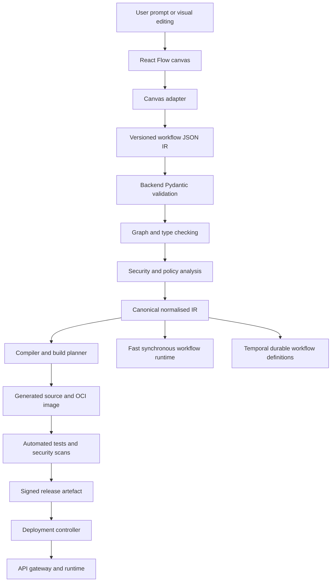

# AI-Native API, GraphQL & MCP Orchestration Platform
## Enterprise product, architecture, security and implementation specification

**Document status:** Proposed reference architecture  
**Product direction:** Enterprise-first, SaaS and self-hosted  
**Creation experience:** Visual workflow builder + natural-language AI generation  
**Integration model:** New and existing APIs, databases, services and AI tools  
**Primary outputs:** REST APIs, GraphQL APIs, MCP servers, workflows and governed agent tools

---

## 1. Executive product definition

Build an enterprise platform that allows a user to describe a business capability in natural language or construct it visually, then design, secure, test, deploy, publish and operate the resulting APIs and AI tools.

The platform is not merely a low-code API builder, an automation canvas or an MCP wrapper. It is a **governed API and agent capability fabric** that connects existing enterprise systems and newly created services through one consistent security, workflow, deployment and observability model.

### 1.1 Product promise

> Describe a business capability once. Generate its architecture, REST and GraphQL interfaces, business workflows, database integrations, security policies, tests and optional MCP tools. Publish it through a governed runtime and manage it throughout its lifecycle.

### 1.2 Target customers

1. **Enterprise architecture and platform teams:** standardise API creation, access control, integration and deployment.
2. **Application development teams:** create and reuse APIs without repeatedly building infrastructure plumbing.
3. **AI engineering teams:** expose approved enterprise capabilities as secure tools for AI agents.
4. **Integration teams:** connect existing databases, APIs, event systems and SaaS platforms.
5. **Regulated organisations:** enforce least privilege, auditability, approvals, tenant separation and deployment controls.

### 1.3 Product principles

- Security is a platform capability, not a workflow decoration.
- REST, GraphQL and MCP are different interfaces to governed business capabilities; they must not create separate authorization systems.
- The visual workflow and natural-language experience produce the same canonical workflow specification.
- AI proposes and generates; deterministic validators and policy enforcement decide what can execute.
- Existing systems are first-class integrations. Customers must not have to migrate their data to use the platform.
- Secrets remain in a vault and are never embedded in prompts, generated source files, browser state or workflow exports.
- Development can be automated; production publication is subject to customer-defined approval policy.
- SaaS and self-hosted deployments use the same logical architecture and portable deployment artefacts.

---

## 2. Three-layer architecture

The platform has three functional layers. Security is enforced across all three layers and cannot be bypassed by switching from REST to GraphQL or MCP.



### 2.1 Layer 1 — Interface and API exposure

Purpose: expose a business capability to applications, services, developers and AI clients.

Supported interfaces:

- REST endpoints.
- GraphQL queries, mutations and subscriptions where supported by the selected runtime.
- MCP servers and tools.
- Webhooks and event-triggered endpoints.
- Internal service-to-service endpoints.
- Generated SDKs and OpenAPI documentation.

Responsibilities:

- Route requests to the correct published version.
- Authenticate caller identity.
- Validate token issuer, audience, expiry and signature.
- Validate API key status where API keys are used.
- Enforce endpoint and operation scopes.
- Validate request parameters and payload schemas.
- Apply rate limits, quotas, request-size limits and network restrictions.
- Attach a trusted identity and authorization context to the request.
- Record request IDs and audit-relevant metadata.

Layer 1 must not be trusted to make all final data-access decisions. It establishes caller identity and initial access context; deeper layers enforce the actual operation and data permissions.

### 2.2 Layer 2 — Business logic and orchestration

Purpose: execute approved business operations and combine capabilities.

Components:

- Workflow graph runtime.
- Business-rule engine.
- Service/API composition engine.
- Input and output transformation.
- Conditional branches and parallel execution.
- Transaction and approval orchestration.
- Durable long-running workflows.
- Agent execution and tool invocation.
- Idempotency and retry handling.
- Policy decision and enforcement integration.

Every business operation must receive a trusted execution context containing, where applicable:

- Tenant and workspace identifiers.
- Authenticated subject and client identity.
- Roles and effective scopes.
- Resource and environment identifiers.
- Approved data classification and policy attributes.
- Correlation and trace IDs.
- Delegation information for agent or service execution.

The context must be created or cryptographically protected by trusted platform components. A client or AI agent must not be able to supply arbitrary roles or elevate its own scopes through request parameters.

### 2.3 Layer 3 — Data access and integration

Purpose: access databases and external systems through controlled connectors.

Responsibilities:

- Secure database and external API connection management.
- Connector-specific authentication.
- Schema and metadata discovery.
- Table, collection, view, field and operation allowlists.
- Parameterised query execution.
- Tenant and row-level restrictions.
- Data masking and response filtering.
- Transaction boundaries and consistency handling.
- Connection pooling and resource limits.
- Data classification and lineage metadata.

The platform must not assume that an application-level check is sufficient for sensitive data. Where the target database supports native controls, use dedicated database principals, row-level security, schemas, views, stored procedures, grants and least-privilege permissions as an additional enforcement layer.

---

## 3. Canonical platform model: one specification, multiple interfaces

A central design requirement is to avoid maintaining independent definitions for REST, GraphQL, MCP and workflow logic.

The platform should store a **Canonical Capability Specification (CCS)**, also called the workflow/API specification, for each published capability.

### 3.1 Canonical specification contains

- Project and capability metadata.
- API resources, operations and versions.
- Input, output and error schemas.
- REST route definitions.
- GraphQL type, query and mutation mappings.
- MCP tool definitions and descriptions.
- Workflow nodes, edges and execution semantics.
- Connector references (not credentials).
- Data-source mappings and allowed operations.
- Roles, scopes, tags and policy references.
- Validation rules and business rules.
- Retry, timeout, idempotency and transaction behaviour.
- Test definitions and expected outcomes.
- Deployment and environment configuration references.
- Ownership, classification and lifecycle metadata.

### 3.2 Canonical specification is the source of truth

The visual canvas is an editor for the canonical specification. Natural-language generation creates or modifies the same specification. REST, GraphQL and MCP publishing are generated projections of that specification.



This keeps the interfaces consistent. If an operation's permission changes, the corresponding REST endpoint, GraphQL resolver and MCP tool must all use the updated policy reference.

### 3.3 Specification versioning

Every saved change produces a revision. A release points to an immutable, validated revision.

Store at least:

- Draft revision.
- Validated revision.
- Released revision.
- Environment deployment revision.
- Parent revision and change summary.
- Author, reviewer and approval evidence.
- Build artefact digest.
- Policy bundle version.
- Connector contract version.

Support visual diffs for workflow changes, API contract diffs, schema changes, permissions changes and generated code changes.

---

## 4. Natural-language, single-prompt API creation

The user should be able to create a substantial first draft from one sentence. A one-line prompt is an entry point, not permission for the AI to invent unknown schemas, grant broad permissions or deploy dangerous operations.

### 4.1 Example prompt

> Create a customer service API using the registered Customer PostgreSQL database. Generate REST and GraphQL interfaces for customer search, customer detail retrieval and profile updates. Support agents can read assigned customers, managers can update permitted profile fields, and administrators can suspend accounts with approval. Do not expose payment-card data. Create an MCP server with read-only tools for the support assistant. Deploy to development first.

### 4.2 AI-generated artefacts

The system should generate:

1. Solution architecture and component diagram.
2. Data-source and schema mapping proposal.
3. REST routes and OpenAPI specification.
4. GraphQL types, queries, mutations and resolver mapping.
5. Workflow graph and typed node configuration.
6. Business rules and field validation.
7. Role, scope and tag matrix.
8. Data access and masking policy proposal.
9. MCP server and tool definitions.
10. Automated functional, negative, integration and security tests.
11. Deployment plan and environment variables (secret references only).
12. Developer documentation and example requests.
13. Operational monitoring and alert suggestions.

### 4.3 Generation stages

**Stage A — Requirement parsing**

Extract entities, operations, users, roles, data sources, interfaces, constraints, sensitivity, expected traffic, failure behaviour and deployment target.

**Stage B — Existing asset discovery**

Search the project's approved connector registry, API catalogue, schemas, reusable components, policy templates and agent/tool catalogue. Only resources that the requesting user is allowed to discover may be considered.

**Stage C — Architecture proposal**

Create a proposed workflow and interface design. Identify missing decisions, incompatible assumptions and risky operations.

**Stage D — Specification generation**

Generate a typed CCS with explicit connector IDs, policy references, schema references and node types. Do not put connection secrets into the specification.

**Stage E — Static validation**

Validate graph structure, data types, interface contracts, policy coverage, connector permissions, scope references, tag rules and deployment constraints.

**Stage F — Test generation and execution**

Create positive, negative, boundary, role-matrix, tenant-isolation, injection, rate-limit and integration tests. Run tests against an isolated environment.

**Stage G — Human review and release**

Show the generated architecture and explain each permission. Require configured approval for sensitive access, schema changes, writes, external data egress and production deployment.

### 4.4 When the AI must ask a question

Ask the smallest necessary clarification when:

- A database or schema cannot be identified unambiguously.
- A write operation has no defined business rule.
- The requested access conflicts with an existing policy.
- A sensitive field has no classification or handling rule.
- A production deployment target or approval policy is missing.
- A destructive migration or irreversible operation is proposed.

Otherwise, generate a safe draft with clearly labelled assumptions. Do not ask users to specify information already available in their registered project assets.

### 4.5 Safe default behaviour

- New database connections are read-only until write access is explicitly approved.
- New APIs are private by default.
- MCP tools are not publicly discoverable by default.
- No wildcard scopes for production.
- No unrestricted GraphQL introspection or unbounded query execution in production.
- No automatic destructive migrations.
- No automatic production deployment unless the organisation has explicitly enabled and scoped that policy.
- No secrets in prompts, generated source, logs or test fixtures.

---

## 5. Database connection and configuration centre

This must be a first-class product area, not a simple text box for a connection string.

Users should be able to register a database through the visual UI or provision it through a secured management API/IaC integration. Both paths create the same server-side connector object.

### 5.1 Supported connection categories

Design a connector framework that can support:

**Relational databases**
- PostgreSQL.
- MySQL and compatible variants.
- Microsoft SQL Server.
- Oracle Database.
- MariaDB.

**Document and key-value databases**
- MongoDB.
- Redis/Valkey for approved operational use cases.

**Analytics and data platforms**
- Snowflake.
- BigQuery.
- Databricks SQL and other warehouse connectors as demand requires.

**Other data services**
- Managed cloud database services.
- Read replicas and reporting databases.
- Approved data APIs and GraphQL services.

Prioritise the connectors most relevant to the initial customer segment. Do not claim every connector is production-supported until its authentication, permissions, pooling, failover and test suite are complete.

### 5.2 Database registration UI

Recommended wizard:

1. Select connector type.
2. Select hosting model (customer cloud, private network, public endpoint with strict controls, or local development).
3. Enter host, port, database, TLS and connection options.
4. Select authentication method.
5. Store credential or identity reference in the secret manager.
6. Configure network route, private connectivity or self-hosted connector agent.
7. Test TLS and authentication.
8. Test least-privilege access.
9. Discover approved schemas, tables, views, collections and metadata.
10. Assign owner, environment, tags and data classification.
11. Choose permitted actions and publish the connector to selected projects.

### 5.3 Authentication methods

Support the strongest method offered by the target service and customer environment:

- Username/password stored in a vault, where unavoidable.
- TLS certificate authentication.
- Mutual TLS where supported.
- Cloud IAM or workload identity.
- Managed identity / instance identity.
- Short-lived credentials and token exchange.
- Database-native authentication mechanisms.
- SSH or private-network tunnel only where approved and managed securely.

All remote database connections should validate server certificates. Never silently fall back to unverified TLS.

### 5.4 UI versus API connection setup

**Important browser security rule:** the browser UI must never open a direct connection to a production database or hold a database password.

- UI configuration submits connection metadata and a secure secret input to the platform control plane.
- The control plane writes the secret to the vault and stores only a secret reference in the connector registry.
- The runtime connector retrieves the secret using its workload identity.
- The browser displays status and masked metadata, not credentials.
- A management API can perform the same registration through a controlled secret-ingestion process.
- Infrastructure-as-code can provision connectors without exposing credentials in source control.

### 5.5 Connection security and operational controls

- Dedicated runtime identity per environment or workload.
- Least-privilege database principal for each connector/use case.
- Read-only mode by default.
- Explicit write, DDL and administrative permissions.
- TLS verification and certificate rotation.
- Network allowlists and private connectivity.
- Connection pooling, per-tenant limits and pool isolation where required.
- Query timeout, statement timeout and result-size limits.
- Prepared statements and parameterised queries.
- Query audit metadata without logging secrets or sensitive result payloads.
- Credential rotation and revocation.
- Connection health checks and circuit breakers.
- Schema-change detection and approval workflow.
- Data egress controls and export restrictions.

### 5.6 Schema discovery and mapping

The connector can introspect approved metadata, but metadata discovery is not data permission.

Provide:

- Schema and table browser.
- Column names and types.
- Primary and foreign keys.
- Views and stored procedures where supported.
- Relationship visualisation.
- Data classification suggestions.
- Sample data preview only with explicit permission and masking.
- Field allowlist and denylist.
- Mapping from source fields to API fields.
- Tenant key and ownership mapping.
- Read/write capability declarations.

Users should be able to hide or deny fields such as passwords, access tokens, payment-card data, government identifiers and internal risk markers.

---

## 6. REST, GraphQL and API composition

### 6.1 REST API Studio

Features:

- Resource and endpoint designer.
- HTTP method and route configuration.
- Request path, query, header and body schemas.
- Response and error schemas.
- Pagination, filtering and sorting.
- Idempotency-key handling for suitable write operations.
- API versioning and deprecation policy.
- Rate limits and quotas.
- OpenAPI import/export.
- Existing API import and proxy mode.
- Mock responses and test console.
- Generated client SDK metadata.

### 6.2 GraphQL Studio

GraphQL should be a native interface, not an afterthought. It can give consumers a flexible query contract, but it also introduces specific risks that must be managed.

Features:

- GraphQL schema designer.
- Schema generation from approved database metadata or existing service contracts.
- Query, mutation and subscription definitions where appropriate.
- Resolver-to-workflow mapping.
- Field-level and object-level authorization.
- Argument validation and input coercion.
- DataLoader/batching support with tenant-aware cache keys.
- Query depth and complexity limits.
- Resolver timeouts and resource budgets.
- Pagination and bounded list sizes.
- Persisted/allowlisted queries for high-control deployments.
- Introspection policy by environment and identity.
- Query analysis and audit events.
- GraphQL schema diff and compatibility checks.

### 6.3 GraphQL security requirements

Never assume that securing the GraphQL endpoint alone protects the data.

Enforce:

- Schema/type access restrictions where needed.
- Field-level authorization.
- Object-level authorization for every returned object.
- Mutation-specific scopes and business rules.
- Tenant filtering in trusted resolvers and data services.
- Query depth, complexity, alias and batch limits.
- Rate and cost limits.
- Resolver deadlines and cancellation.
- Protection against N+1 query amplification.
- Safe introspection and error detail policies.
- No direct arbitrary SQL from client-controlled GraphQL arguments.

REST and GraphQL must call the same underlying business capabilities and policy enforcement functions. A user denied an operation through REST must not gain that operation by using a GraphQL mutation.

### 6.4 API composition

Allow a workflow to combine:

- APIs created in the platform.
- Existing REST and GraphQL APIs.
- Internal microservices.
- Database connectors.
- SaaS connectors.
- Event and messaging systems.
- AI model endpoints and approved agent tools.

Composition nodes should support sequential, conditional, parallel and fan-out/fan-in execution, with explicit timeout, retry, compensation, error and idempotency policies.

---

## 7. Tags, scopes, roles and policy model

These concepts must be related but not conflated.

### 7.1 Roles — who the user or service is allowed to act as

Example roles:

- Platform Owner.
- Organisation Administrator.
- Security Administrator.
- Project Administrator.
- API Designer.
- Developer.
- Publisher / Release Approver.
- Operator.
- Auditor.
- Read-only Consumer.
- Agent Runtime Identity.

RBAC should govern what platform users can do in the platform. Runtime API authorization also needs resource and data-aware checks.

### 7.2 Scopes — which operations a token or client may request

Examples:

- `customer:read`
- `customer:search`
- `customer:profile:update`
- `account:status:read`
- `account:status:update`
- `transaction:read`
- `payment:create`
- `payment:approve`
- `customer:pii:read`

Scopes should be narrow, resource-oriented and action-oriented. Avoid broad wildcard scopes in production.

### 7.3 Tags — metadata used to classify and select resources

Tags are labels, not permissions by themselves.

Examples:

- `domain:customer`
- `data-classification:confidential`
- `data-classification:restricted`
- `environment:production`
- `owner:customer-platform`
- `region:au`
- `tenant:isolated`
- `interface:graphql`
- `exposure:mcp-approved`
- `operation:read-only`
- `approval:required`

Tags can be used by policy rules to make governance manageable. For example, a policy can require security approval before publishing any resource tagged `data-classification:restricted` to an external MCP server.

Users must not be able to grant themselves access simply by adding a tag. Only authorised governance processes can assign security-sensitive tags or change tag-controlled policies.

### 7.4 RBAC + ABAC + resource relationships

Use a combined model:

- **RBAC:** platform roles and responsibilities.
- **ABAC:** decisions based on tenant, environment, resource classification, location, device posture, operation and other approved attributes.
- **Relationship-based checks:** ownership, assigned customer, team membership or resource relationship where required.
- **Scopes:** delegated capability claims for API clients and agents.

### 7.5 Policy evaluation

Use a central policy decision point (PDP) and enforcement points at each relevant boundary.

Recommended pattern:

- API gateway: initial authentication, client/endpoint policy and coarse rate controls.
- API runtime: operation authorization.
- GraphQL resolver: type, field, object and mutation authorization.
- Workflow nodes: operation-specific policy checks.
- MCP tool execution: tool-specific authorization and delegated identity.
- Data connector: datasource, schema, operation and tenant policy.
- Database: native grants, row-level security, views or separate principals where supported.

A policy engine such as OPA can be used for centrally managed policy decisions, with explicit policy versioning, test fixtures, decision logs and fail-closed behaviour for protected operations.

---

## 8. MCP Server Builder and governance

The platform should turn approved capability definitions into one or more MCP servers.

### 8.1 MCP creation flow

1. Select an existing project or capability.
2. Select REST/GraphQL operations or underlying approved business capabilities.
3. Choose which operations become MCP tools.
4. Generate tool names, descriptions, input schemas and result schemas.
5. Assign audience, agent clients and identity requirements.
6. Map tool execution to the canonical operation and policy.
7. Configure read/write classification, rate limits and approval requirements.
8. Run schema and security tests.
9. Publish a versioned MCP server.

### 8.2 MCP tool policy

Each MCP tool must have:

- Stable tool identifier and version.
- Human-readable description.
- Typed input and output schema.
- Classification and tags.
- Required scope(s).
- Allowed client/agent identities.
- Resource and tenant restrictions.
- Rate and execution limits.
- Side-effect classification.
- Human approval policy, where needed.
- Audit and trace configuration.
- Source capability and policy references.

### 8.3 Security inheritance

MCP tools must invoke the same canonical capability and policy path as REST and GraphQL. Do not copy a database query into a separately privileged MCP service.

When possible, preserve the end-user or calling-agent identity through token exchange or an explicitly configured delegated execution model. If a service identity is used, make its authority narrow, auditable and distinct from user-delegated authority.

Do not let an agent choose an arbitrary tenant ID, customer ID or security role to gain access. Resource ownership must be checked in trusted server-side logic.

### 8.4 MCP risk controls

- Separate discovery permission from invocation permission.
- Per-tool scopes and client allowlists.
- Read-only tools by default.
- Explicit approval for financial, destructive or externally consequential actions.
- Argument validation and bounds.
- No secret-returning tools unless explicitly justified and governed.
- Tool result minimisation and sensitive-field redaction.
- Tool call rate and cost budgets.
- Complete trace linkage from agent request to tool execution to data access.
- Version and deprecation management.
- Security tests for confused-deputy and cross-tenant access risks.

The implementation must pin and test against the supported MCP protocol and transport versions. Do not assume that descriptive tool annotations are security enforcement.

---

## 9. Agentic Workspace — multi-agent engineering environment

This should be a dedicated area of the product, not merely a chat panel attached to the workflow canvas.

It enables customers to configure, tune, test and orchestrate specialised agents that help design, build, review and operate APIs.

### 9.1 Agent roles

A recommended initial agent team:

| Agent | Responsibility | Required output |
|---|---|---|
| Supervisor / Orchestrator | Break down work, assign tasks, manage dependencies and state | Execution plan and task graph |
| Requirements Analyst | Extract entities, operations, constraints and ambiguities | Requirement specification |
| Solution Architect | Select platform components and define service boundaries | Architecture proposal |
| Database Architect | Inspect approved schema metadata and propose data mappings | Data model and connector plan |
| API Architect | Design REST contracts and versioning | OpenAPI and API specification |
| GraphQL Architect | Design types, queries, mutations and resolver mapping | GraphQL schema and policy map |
| Workflow Engineer | Build canonical workflow graph and integration paths | Typed workflow specification |
| Security Architect | Design roles, scopes, tags and policy requirements | Policy bundle proposal and threat model |
| MCP Engineer | Create approved MCP tools and server definitions | MCP server specification |
| Implementation Agent | Generate or configure implementation artefacts | Build artefacts / code changes |
| Test Architect | Design functional, negative, integration and regression tests | Test plan and executable tests |
| Security Tester | Probe authorization, injection, isolation and data leakage | Findings and evidence |
| Reviewer / Critic | Independently challenge assumptions and generated outputs | Review report and required changes |
| Release Agent | Prepare deployment and release evidence | Deployment plan, not unilateral approval |
| Operations Agent | Review telemetry, failures and performance | Operational findings and remediation proposals |

Agents should be configurable. Not every project needs every specialist, but high-risk workflows must not be able to skip mandatory security and validation stages merely because an agent is disabled.

### 9.2 Agent configuration UI

Each agent has:

- Name and role.
- Purpose and responsibilities.
- System instructions / role prompt.
- Model provider and model selection.
- Temperature and other supported inference parameters.
- Tool allowlist.
- Data-source and retrieval permissions.
- Input and output schema.
- Memory policy and retention.
- Maximum turns / token budget / cost budget.
- Timeout and retry behaviour.
- Approval requirements.
- Version, owner and enabled status.
- Evaluation suite and quality score.

Prompt tuning must be versioned. Users should be able to compare versions against a fixed evaluation dataset before promoting a new agent configuration.

### 9.3 Orchestration patterns

Support:

- Supervisor-to-specialist delegation.
- Sequential hand-offs.
- Parallel independent reviews.
- Debate / critique and revise loops with a bounded iteration count.
- Human approval checkpoints.
- Durable resumable tasks.
- Conditional routing based on risk and validation outcomes.

The orchestrator must not be a superuser that can bypass security. Every agent has a separate workload identity and explicit tool permissions.

### 9.4 Independent verification

For important changes, separate generation from verification:

1. One agent proposes the design.
2. Another agent reviews the design against requirements.
3. A security agent evaluates the policy and threat model.
4. Automated validators check the machine-readable artefacts.
5. Test agents execute the tests.
6. A release reviewer presents evidence for approval.

The same model can sometimes perform different roles, but independent model/provider configurations are preferable for critical reviews. Model diversity is not a substitute for deterministic checks.

### 9.5 Agent evaluation and retuning

Provide:

- Golden task datasets.
- Expected workflow/schema outputs.
- Security regression prompts.
- Tool-use success metrics.
- Unsupported-assumption detection.
- Hallucinated connector or schema detection.
- Prompt injection resistance tests.
- Cost, latency and token metrics.
- Human ratings and review comments.
- Version-to-version comparison.
- Promotion and rollback controls.

An agent should not be labelled production-ready just because its prompt has been edited. It must pass its assigned evaluations.

---

## 10. LLM Provider and Model Configuration Centre

Create a central **Model Provider Hub** where an administrator can register multiple providers and endpoint configurations.

### 10.1 Provider configuration fields

- Provider name and provider type.
- API protocol / compatibility mode.
- Base URL or API endpoint.
- API key or credential reference.
- Model identifier.
- Optional deployment or resource name.
- Required custom headers, stored securely where sensitive.
- Region and data-processing classification.
- Request timeout and retry policy.
- Rate limits and concurrency limits.
- Token/context limits where known.
- Supported capabilities: text, structured output, tool calling, vision, embeddings, etc.
- Cost metadata where available.
- Health-check and test-connection configuration.
- Enabled projects and permitted agent roles.

Support managed providers and compatible custom endpoints. For example, customers may use hosted model providers, an enterprise gateway, or a private model endpoint running in their own environment. Local inference systems can be connected through an approved API endpoint.

### 10.2 Model selection per agent

The same provider configuration can be assigned to multiple agents, but permissions should be scoped separately.

Example:

| Agent role | Model configuration | Reason |
|---|---|---|
| Supervisor | Strong reasoning model | Planning and coordination |
| API Architect | Coding/reasoning model | API and schema design |
| Security Reviewer | Independent reasoning model | Critical review |
| Implementation Agent | Coding model | Implementation tasks |
| Test Agent | Coding/reasoning model | Test creation and repair |
| Fast Classifier | Low-latency model | Routing and extraction |

Allow separate keys per agent, project or provider. Reusing one provider connection is permissible when organisational policy allows it, but agent identity and access controls must remain separate.

### 10.3 Model routing and fallback

Support rules such as:

- Use a lower-cost model for classification.
- Use a high-capability model for architecture and security review.
- Use an approved private model for restricted data.
- Retry with an approved fallback only when the data classification permits it.
- Do not send restricted data to an unapproved provider.

Record model/provider selection, request metadata, latency, token usage, outcome and cost. Avoid recording raw prompts or outputs containing sensitive information unless retention is explicitly enabled and approved.

### 10.4 Provider security

- Credentials are stored in the secret manager.
- Keys are not returned to the browser after creation.
- Support rotation, disablement and expiry.
- Restrict which projects and agents can use each provider.
- Apply outbound network allowlists and SSRF controls to custom endpoints.
- Validate TLS certificates and endpoint ownership.
- Avoid forwarding user-supplied arbitrary URLs directly from privileged workers.
- Apply data classification and residency rules before model invocation.
- Provide per-provider budgets, rate limits and circuit breakers.

### 10.5 Provider test experience

The UI should allow an administrator to:

1. Register an endpoint and secret.
2. Select or enter the model ID.
3. Test authentication and connectivity.
4. Test structured output or tool calling if required.
5. Run a sample task using synthetic data.
6. Review latency and capability results.
7. Assign the provider to approved agents/projects.

Do not assume all OpenAI-compatible endpoints implement every feature identically. Store tested capability flags rather than inferring complete compatibility from a URL format.

---

## 11. Workflow Engine and execution model

### 11.1 Visual canvas

Use a typed node-and-edge graph. Nodes should have validated input and output ports. The UI should support:

- Drag and drop.
- Connect and disconnect.
- Group, collapse and reuse sub-workflows.
- Zoom, pan and minimap.
- Node configuration panels.
- Inline schema and permission indicators.
- Validation messages and dependency highlighting.
- Execution preview and node-level test.
- Version diff and rollback.
- Natural-language editing of selected nodes or the whole graph.

### 11.2 Core node categories

**Entry nodes:** REST trigger, GraphQL resolver trigger, MCP tool trigger, webhook, schedule, event trigger.

**Security nodes:** authentication context, authorization check, scope check, role/attribute check, approval checkpoint. These nodes visualise policy usage but do not replace mandatory enforcement in the runtime.

**Data nodes:** database select/insert/update, stored procedure, schema mapping, data validation, redaction, external API request.

**Logic nodes:** condition, switch, loop with strict bounds, transform, merge, map, filter, validation, error handler.

**Integration nodes:** REST client, GraphQL client, SaaS connector, message publish/consume, file operation.

**AI nodes:** model call, structured extraction, classification, agent call, retrieval, human review.

**Flow control nodes:** parallel branch, join, sub-workflow, retry, timeout, compensation, wait, approval.

**Output nodes:** REST response, GraphQL result, MCP result, event publish, audit event.

### 11.3 Execution engines

Separate the synchronous API request path from durable long-running workflow orchestration.

- A low-latency workflow runtime executes ordinary synchronous API operations.
- A durable workflow engine such as Temporal handles long-running processes, retries, waits, human approvals, scheduled work and recovery.
- A worker pool executes approved connector and custom-code tasks.
- Custom code runs in isolated sandboxes/containers with restricted network, CPU, memory, filesystem and time limits.

Do not route every simple REST request through a long-running orchestration engine if that adds unnecessary latency and operational complexity.

### 11.4 Execution guarantees

Define semantics explicitly:

- At-least-once activity execution where applicable.
- Idempotency keys for repeatable write requests.
- Retry only for classified transient errors.
- Bounded retry budgets and exponential backoff with jitter.
- Dead-letter handling for failed asynchronous tasks.
- Compensation workflows for distributed operations where true rollback is impossible.
- Explicit transaction boundaries for database operations.
- Cancellation and timeout propagation.
- Per-tenant and per-workflow concurrency limits.
- Deterministic workflow definitions for durable execution.

### 11.5 Custom code execution

Allow custom code only as a controlled extension point:

- Approved language/runtime images.
- Signed or content-addressed artefacts.
- Isolated execution environment.
- No host filesystem access.
- No ambient cloud credentials.
- Default-deny network egress.
- Explicit connector access via scoped bindings.
- CPU, memory, output and time limits.
- Dependency scanning and provenance.
- Static analysis and tests before publication.

---

## 12. Product UI modules and navigation

Recommended top-level navigation:

1. Overview.
2. Projects and Workspaces.
3. API Builder.
4. Workflow Studio.
5. Database & Connectors.
6. GraphQL Studio.
7. MCP Studio.
8. Agentic Workspace.
9. Model Provider Hub.
10. Security & Policies.
11. API Marketplace.
12. Testing & Validation.
13. Deployments & Environments.
14. Monitoring & Audit.
15. Developer Portal.
16. Organisation Settings.

### 12.1 Overview dashboard

- Published APIs and versions.
- GraphQL services and schemas.
- MCP servers and tools.
- Active deployments.
- API request volume and latency.
- Error rates and failed workflows.
- Security alerts and policy denials.
- Database connector health.
- Model usage and cost.
- Pending approvals.

### 12.2 Project workspace

A project owns related capabilities, workflows, APIs, schemas, connectors, policies, agents, environments and releases. Support organisation-level templates and shared resources with explicit access control.

### 12.3 API Builder

Provide both:

- Prompt-based creation panel.
- Visual REST/API workflow editor.

Show the generated architecture as editable objects, not as an opaque chat response. Highlight missing configuration, inherited policies and generated artefacts.

### 12.4 Database & Connector Centre

Include connection registry, registration wizard, connection test, schema explorer, permission editor, data classification, connector health, credential rotation status and change history.

### 12.5 GraphQL Studio

Include schema explorer, resolver mapping, query/mutation editor, permission matrix, query-cost settings, introspection controls, schema diff and sandbox query console.

### 12.6 MCP Studio

Include server registry, tool selection, tool schema editor, identity/client mapping, per-tool scopes, side-effect classification, test client, audit view and versioning.

### 12.7 Agentic Workspace

Include agent catalogue, visual agent orchestration graph, per-agent model/provider selection, prompt editor, tool permissions, memory/retrieval controls, test/evaluation centre, execution trace and cost dashboard.

### 12.8 Model Provider Hub

Include provider registry, endpoint configuration, secret reference, model ID, capability tests, agent assignment, usage budget, health and failover configuration.

### 12.9 Security Centre

Include roles, groups, scopes, tags, policies, API clients, service identities, data classifications, approval rules, policy simulation, audit events and security findings.

### 12.10 Deployments and environments

Include development, staging and production; release diff; approval workflow; configuration/secret references; rollout status; health checks; rollback; and deployment evidence.

---

## 13. Identity, security and governance architecture

### 13.1 Identity integration

Support enterprise identity federation through established protocols such as OIDC and SAML. Provide SCIM-based provisioning where required. Support MFA and customer-defined authentication policies through the identity provider.

Separate:

- Human user identities.
- API client identities.
- Workload/service identities.
- Agent identities.
- External MCP client identities.

Do not use a human administrator's token as a permanent runtime credential.

### 13.2 Authentication and token validation

- Validate signature, issuer, audience, expiry and intended token use.
- Use short-lived access tokens where practical.
- Support refresh/revocation strategy according to the identity provider.
- Use OAuth scopes for delegated API capabilities.
- Use mTLS or workload identity for sensitive service-to-service channels.
- Treat API keys as identifiers/secrets for suitable use cases, not as a replacement for strong user identity and fine-grained authorization.

### 13.3 Authorization architecture

Use central policy definition and distributed policy enforcement.

Policy inputs can include:

- Subject identity and type.
- Organisation, workspace and tenant.
- Role and group memberships.
- Token scopes.
- Requested action and resource.
- Resource owner and relationship.
- Data classification tags.
- Environment.
- Network/client context where permitted.
- Agent delegation chain.
- Operation risk and approval state.

Protected operations should fail closed when the policy service is unavailable or the decision cannot be verified. Define carefully controlled cached decisions only for low-risk use cases with short expiry and revocation strategy.

### 13.4 Tenant isolation

Support a configurable isolation model:

- Shared control plane with strict tenant context.
- Shared runtime with tenant-aware execution boundaries for lower-risk plans.
- Dedicated runtime/namespace for higher assurance.
- Dedicated database or customer-managed data plane for regulated deployments.

Tenant context must be applied to queries and cache keys. Never trust tenant IDs provided solely in request parameters.

### 13.5 Data classification and privacy

Support classification levels configurable by the customer, for example:

- Public.
- Internal.
- Confidential.
- Restricted.

Policies should govern storage, model-provider use, logging, MCP exposure, masking, export and retention according to classification.

### 13.6 Secrets management

- Integrate a dedicated secret manager such as Vault or OpenBao, or customer-approved cloud secret stores.
- Store secret references in connector and provider records.
- Use workload identity to retrieve secrets.
- Rotate and revoke credentials.
- Prevent secrets from being returned through APIs or UI after creation.
- Scan generated artefacts and logs for accidental secret exposure.

### 13.7 Audit and evidence

Record:

- Who created or changed an API, workflow, schema, agent or policy.
- Who approved a release.
- Which revision was deployed.
- Which identity invoked an API or MCP tool.
- Which policy decision was made and which policy version was used.
- Which connector and resource were accessed.
- Whether a write or consequential action occurred.
- Which agent/model/provider executed a task, with appropriate privacy controls.

Protect audit records from alteration and define customer-configurable retention and export.

### 13.8 Threat model and security testing

Include tests for:

- Broken object-level authorization.
- Broken function-level authorization.
- Cross-tenant data access.
- Scope escalation.
- GraphQL depth/complexity and alias abuse.
- SQL/NoSQL injection.
- SSRF through custom API/model endpoints.
- Credential leakage.
- Prompt injection and malicious retrieved content.
- MCP tool misuse and confused-deputy behaviour.
- Unsafe generated code and dependency compromise.
- Excessive data exposure.
- Resource exhaustion and denial-of-service.
- Insecure workflow exports and secret-bearing logs.

Map controls to the customer's applicable security framework and the current versions of relevant API, cloud and application security standards during implementation. This specification is an architecture proposal, not a compliance certification.

---

## 14. Control plane and data plane deployment architecture

Because deployment must support both SaaS and self-hosted customers, separate the control plane from the execution data plane.

### 14.1 Control plane responsibilities

- Web UI and management API.
- Organisation, project and user management.
- Workflow/API specification registry.
- Agent and model-provider configuration.
- Policy authoring and policy distribution.
- Connector metadata registry.
- Build and validation orchestration.
- Deployment coordination.
- API catalogue and developer portal metadata.
- Usage metering and licensing.

### 14.2 Data plane responsibilities

- API gateway / ingress.
- REST and GraphQL runtimes.
- MCP server runtime.
- Workflow execution runtime.
- Connector workers.
- Policy enforcement points and local policy bundle cache.
- Secrets retrieval through approved identity.
- Observability collectors.

### 14.3 SaaS deployment

The vendor hosts the control plane and managed data plane. Enterprise customers can select shared or dedicated data-plane isolation according to the service tier and risk profile.

For private customer systems, deploy a customer-side connector/runtime agent. It establishes an authenticated outbound connection to the control plane or a customer-managed broker. Avoid requiring inbound exposure of internal databases.

### 14.4 Self-hosted deployment

Provide a supported deployment package for the customer's Kubernetes or approved container environment. The customer controls:

- Control-plane hosting or a licensed management-plane connection.
- Data-plane runtime.
- Database and model connectivity.
- Secret store.
- Network policy.
- Identity provider.
- Logs and telemetry destination.
- Backup, retention and disaster recovery.

The self-hosted product must not require the platform vendor to receive customer database credentials or sensitive payloads.

### 14.5 Reference deployment diagram



### 14.6 Network design

- Separate management and runtime networks.
- Private connectivity to sensitive databases.
- Default-deny egress for connector and custom-code workers.
- Explicit egress allowlists for model and external API endpoints.
- mTLS/service identity between internal services.
- No public database ingress requirement.
- Customer-controlled routing for self-hosted data planes.

### 14.7 Resilience and disaster recovery

Define service-level objectives by tier. Include multi-zone deployment, database backup and restore, workflow recovery, connector failover, queue durability, control-plane recovery, policy bundle availability and tested rollback procedures.

---

## 15. Suggested technical stack

These are recommended starting choices, not mandatory dependencies.

| Area | Suggested technology | Rationale |
|---|---|---|
| Frontend | Next.js + TypeScript | Enterprise web application |
| Workflow canvas | React Flow | Node/edge visual editor |
| Backend management API | Python + FastAPI | Typed API development and AI integration |
| Agent orchestration | LangGraph or a custom bounded orchestrator | Multi-agent state and controlled delegation |
| Durable workflows | Temporal | Long-running processes, retries and approvals |
| Platform registry | PostgreSQL | Projects, specs, policy metadata and versions |
| Cache | Redis/Valkey | Cache and transient coordination |
| API gateway | Kong or Envoy-based gateway | Routing, authentication integration and rate control |
| Policy engine | Open Policy Agent | Externalised policy decision logic |
| Secrets | Vault / OpenBao / cloud secret manager | Central secret lifecycle |
| Runtime packaging | OCI containers | Portable deployment artefacts |
| Orchestration | Kubernetes | Enterprise-scale runtime and self-hosting |
| Observability | OpenTelemetry + Prometheus + Grafana | Traces, metrics and dashboards |
| Logs | Customer-selected central logging stack | Retention and integration flexibility |
| API contract | OpenAPI | REST contracts and tooling |
| GraphQL | Established GraphQL runtime with custom policy middleware | Schema and resolver execution |
| MCP | Officially maintained SDK/protocol implementation | MCP server and client compatibility |
| Artefact storage | S3-compatible object storage / customer equivalent | Builds, reports and exported packages |

### 15.1 Important technology boundary

Do not make Temporal the transport path for every synchronous API call. Use it for durable orchestration. Use a low-latency API/workflow runtime for ordinary request-response work.

Do not expose direct database connectivity from the browser. Do not make the LLM the runtime policy engine. Do not let generated source code become the only stored representation of a workflow.

---

## 16. Core domain entities and data model

A starting platform data model should include:

| Entity | Purpose |
|---|---|
| Organisation | Customer organisation / tenant root |
| Workspace | Team boundary |
| Project | Related API and workflow assets |
| User | Human identity reference |
| Group | Team membership |
| PlatformRole | Platform-level privileges |
| ApiClient | OAuth client or API consumer |
| ServiceIdentity | Runtime identity |
| AgentIdentity | Individual agent identity |
| Connector | Database or external system reference |
| SecretReference | Vault path/reference, never secret value |
| DataAsset | Database schema/table/collection/field metadata |
| Capability | Business capability definition |
| CapabilityRevision | Immutable canonical specification revision |
| Workflow | Workflow metadata |
| WorkflowNode | Typed node configuration |
| WorkflowEdge | Directed edge and port mapping |
| ApiOperation | REST operation mapping |
| GraphqlSchemaRevision | GraphQL schema revision |
| GraphqlResolver | Resolver-to-capability mapping |
| McpServer | MCP server definition |
| McpTool | Tool definition and policy reference |
| Scope | Fine-grained capability permission |
| Tag | Governance metadata |
| Policy | Policy metadata and version reference |
| PolicyBundle | Released policy artefact |
| Agent | Agent definition |
| AgentRevision | Prompt/model/tool configuration revision |
| ModelProvider | Provider endpoint metadata |
| ModelDeployment | Model ID and deployment configuration |
| TestSuite | Test collection |
| TestRun | Execution and evidence |
| BuildArtifact | Immutable generated build output |
| Deployment | Environment release record |
| Approval | Human or policy approval evidence |
| AuditEvent | Security and lifecycle event |
| UsageRecord | Request, model, workflow and cost metering |

All records must have tenant/workspace ownership and lifecycle metadata where relevant. Use immutable revision records for published artefacts.

---

## 17. API and management surface

The platform itself should be API-first. Anything possible in the UI should have an appropriate management API, subject to the same authorisation rules.

Illustrative management routes:

```text
POST   /v1/projects
POST   /v1/connectors
POST   /v1/connectors/{id}/test
GET    /v1/connectors/{id}/schema
POST   /v1/capabilities/generate
POST   /v1/capabilities/{id}/validate
POST   /v1/capabilities/{id}/revisions
GET    /v1/capabilities/{id}/revisions/{revision}
POST   /v1/capabilities/{id}/deployments
POST   /v1/graphql-services
POST   /v1/mcp-servers
POST   /v1/mcp-servers/{id}/tools
POST   /v1/agents
POST   /v1/agents/{id}/evaluations
POST   /v1/model-providers
POST   /v1/policies/simulate
POST   /v1/approvals/{id}/decision
GET    /v1/audit-events
GET    /v1/usage
```

These are illustrative contracts. Final routes, request schemas, pagination, idempotency and error models should be defined in the platform's own OpenAPI specification.

### 17.1 External developer experience

For each published API provide:

- Base URL and environment.
- OpenAPI document.
- Authentication instructions.
- Required scopes.
- Example requests and responses.
- Error catalogue.
- Rate limits and quotas.
- Version and deprecation status.
- SDK or code snippets where supported.
- Sandbox / test credentials.

For GraphQL provide schema docs, approved operation examples and query-cost guidance. For MCP provide server connection instructions, tool catalogue and client identity setup.

---

## 18. Testing and release gates

No generated API should be considered production-ready solely because it compiles or returns a successful response.

### 18.1 Required test categories

- Specification/schema validation.
- Workflow graph validation.
- Unit tests.
- REST contract tests.
- GraphQL schema and resolver tests.
- MCP protocol and tool contract tests.
- Database integration tests.
- Positive authorisation tests.
- Negative authorisation tests.
- Cross-role and cross-tenant tests.
- Data masking and field exposure tests.
- SQL/NoSQL injection tests.
- GraphQL depth/complexity tests.
- Rate-limit and resource exhaustion tests.
- Retry, timeout and idempotency tests.
- Failure and recovery tests.
- Load and performance tests.
- Secret leakage and log-scrubbing tests.
- Agent prompt-injection and unsafe tool-use tests.

### 18.2 Permission matrix tests

For every operation, generate tests across:

- Each intended role.
- Each relevant scope combination.
- Valid and invalid tenant/resource ownership.
- Read versus write.
- Approved versus unapproved client/agent.
- Development versus production environment.
- Sensitive versus non-sensitive fields.

A release should fail if an operation has no explicit policy decision or if a protected interface can reach a capability without the required enforcement.

### 18.3 Release gates

**Development:** build, schema, static, unit and baseline security tests pass.

**Staging:** integration, role matrix, data isolation, performance smoke and MCP/GraphQL tests pass.

**Production:** authorised approval, complete evidence, signed artefact, approved policy bundle, secret references verified, rollback path available and deployment health checks pass.

---

## 19. Observability and operations

Provide a unified trace across:

`Client → Gateway → AuthN/AuthZ → REST/GraphQL/MCP → Workflow → Agent/Model → Connector → Database/API`.

Capture:

- Request and correlation IDs.
- Capability and revision IDs.
- Endpoint, GraphQL operation or MCP tool name.
- Authenticated client and subject identifiers where safe.
- Policy decision and policy version.
- Workflow and node timings.
- Connector name and target category.
- Model provider/model ID and usage metadata.
- Latency, errors, retries and timeout events.
- Rate-limit and quota decisions.
- Deployment version.

Do not place raw secrets, full sensitive payloads or credentials in traces. Apply data minimisation, configurable sampling and retention.

Dashboards should include API usage, p50/p95/p99 latency, error rates, GraphQL query cost, MCP tool usage, workflow failures, database pool health, agent success rate, model spend and policy denials.

---

## 20. Phased implementation plan

The following is an implementation sequence, not a delivery-time guarantee. Each phase should have a demonstrable working product and acceptance criteria.

### Phase 0 — Architecture foundation

Build:
- Tenant/workspace/project model.
- Canonical Capability Specification schema.
- Revision and artefact registry.
- Identity integration and basic roles.
- Secret-reference abstraction.
- Typed node catalogue and graph validator.

Exit criteria:
- A workflow can be stored, versioned and validated without executing arbitrary code.
- A project has clear tenant boundaries.
- Secrets are not stored in the platform registry as plain text.

### Phase 1 — Database and connector centre

Build:
- Database registration UI and management API.
- PostgreSQL connector as the first production-grade connector.
- TLS verification and secure secret storage.
- Read-only default and connector permission profiles.
- Schema discovery and metadata browser.
- Connector test and health status.
- Development-only data preview with masking.

Exit criteria:
- A user can register a database through UI or API.
- The platform can discover approved schema metadata.
- A runtime workload can access only the configured objects and operations.
- Browser clients never receive database credentials.

### Phase 2 — REST API and visual workflow MVP

Build:
- Natural-language API generation.
- Visual workflow canvas.
- REST trigger and response nodes.
- Database read nodes and controlled write nodes.
- Validation and transformation nodes.
- OpenAPI generation.
- Low-latency synchronous runtime.
- Development deployment.

Exit criteria:
- A user can generate an API from a prompt, edit its graph, test it and publish it to a development endpoint.
- REST requests use the central policy and connector execution path.

### Phase 3 — Enterprise security foundation

Build:
- RBAC and groups.
- Scopes and API client identities.
- Tags and classification model.
- Policy decision/enforcement integration.
- Data-level allowlists and tenant context.
- Audit events.
- Permission matrix test generation.
- Approval rules.

Exit criteria:
- Access is consistently enforced across all runtime operations.
- Negative tests prove that forbidden roles and tenants cannot access protected data.

### Phase 4 — GraphQL Studio

Build:
- GraphQL schema generation and editor.
- Resolver mapping to canonical capabilities.
- Field/object/mutation authorisation.
- Query complexity/depth controls.
- Tenant-aware batching and pagination.
- Schema diff and query console.

Exit criteria:
- REST and GraphQL use identical underlying business policies.
- GraphQL cannot expose a field or operation forbidden through the canonical capability.

### Phase 5 — API composition and durable workflows

Build:
- Existing REST and GraphQL API imports.
- Service composition nodes.
- Conditional and parallel execution.
- Durable workflows with Temporal or equivalent.
- Retry, timeout, idempotency and compensation patterns.
- Reusable sub-workflows.

Exit criteria:
- A capability can safely compose newly created and existing services.
- Long-running workflows can resume after worker or process failure.

### Phase 6 — MCP Studio

Build:
- MCP server publisher.
- Tool selection from canonical capabilities.
- Typed tool schemas.
- Per-tool identity and scopes.
- Approval and side-effect classification.
- MCP test client and audit integration.

Exit criteria:
- MCP tools invoke the same business and data policies as REST/GraphQL.
- A read-only MCP client cannot invoke write operations.

### Phase 7 — Agentic Workspace and Model Provider Hub

Build:
- Provider registry with custom base URL and secret reference.
- Per-agent model assignment.
- Supervisor and specialist agents.
- Agent prompt/version management.
- Tool allowlists and agent identities.
- Evaluation datasets and retuning workflow.
- Multi-agent traces, budgets and cost controls.

Exit criteria:
- A configured agent team can produce a validated capability proposal.
- Agents cannot exceed assigned tools, data permissions or model-provider policies.
- Changes to agent prompts/configurations are versioned and evaluated.

### Phase 8 — SaaS and self-hosted enterprise hardening

Build:
- Managed and customer-hosted data-plane options.
- Deployment controller and signed artefacts.
- Kubernetes packaging and upgrade strategy.
- Private connector agent.
- Environment promotion and rollback.
- SSO/SCIM enhancements.
- Advanced audit export and customer observability integration.
- Backup, disaster recovery and tenant isolation options.

Exit criteria:
- The same canonical project can be deployed to managed and customer-hosted runtime targets without changing its business specification.
- Customer secrets and sensitive data remain in the customer-controlled boundary for supported self-hosted configurations.

### Phase 9 — Marketplace and ecosystem

Build:
- API and MCP catalogue.
- Reusable templates and policy packs.
- Connector marketplace.
- Organisation-wide discovery and ownership.
- SDK generation and broader language support.
- Usage-based billing and governance analytics.

---

## 21. MVP scope: what to build first and what not to build yet

### Build first

- Tenant, workspace and project model.
- Prompt-to-canonical-spec generation.
- Visual workflow builder.
- PostgreSQL connector.
- REST endpoint generation and runtime.
- OpenAPI output.
- RBAC, scopes and tag metadata.
- Central policy checks and audit events.
- Automated tests and development deployment.
- Basic model-provider configuration.

### Add immediately after the first end-to-end workflow works

- GraphQL with field/object authorization.
- Existing API integrations.
- Durable workflow execution.
- MCP publisher.
- Multi-agent planning and independent review.

### Defer until architecture is proven

- Dozens of database connectors.
- Arbitrary user code in shared runtimes.
- Fully autonomous production releases.
- Complex marketplace economics.
- Broad support for every model-specific feature.
- Sophisticated visual policy DSL before core policy semantics are stable.

The first demo should be narrow but complete: create a customer API from a prompt, connect to a registered PostgreSQL database, apply role/scope restrictions, publish a REST endpoint, and prove with automated tests that an unauthorised caller cannot access restricted fields. Then expose the same approved capability through GraphQL and MCP.

---

## 22. Product differentiators and commercial positioning

Position the product as:

**An enterprise API and AI capability fabric — create once, govern centrally, expose everywhere.**

Potential differentiators:

1. One prompt creates an editable, typed and testable architecture.
2. One canonical capability powers REST, GraphQL and MCP.
3. Database access is registered, governed and least-privileged.
4. Roles, scopes, tags and data policies are centrally managed.
5. Multi-agent engineering has independent review and evaluation.
6. Bring-your-own-model endpoint and private inference support.
7. Existing APIs and databases can be reused without migration.
8. The same product supports managed cloud and customer-hosted deployment.

Avoid competing only on the number of visual nodes. The moat should be trusted enterprise governance, interoperability, traceability, safe AI generation and operational lifecycle management.

---

## 23. Key architectural decisions to lock before implementation

| Decision | Recommendation |
|---|---|
| Source of truth | Typed Canonical Capability Specification |
| Visual builder | Editor for the canonical specification |
| AI generation | Multi-agent proposal pipeline with deterministic validation |
| Database access | Server-side connectors; no browser-to-database access |
| First database | PostgreSQL, then prioritised enterprise connectors |
| API interfaces | REST and GraphQL from the same business capabilities |
| MCP | Tool projection of approved canonical capabilities |
| Security | RBAC + ABAC + scopes + relationship checks + native DB controls |
| Tags | Governance metadata and policy selectors, not standalone permissions |
| Policy enforcement | Gateway, runtime, resolver, workflow, MCP and connector enforcement points |
| Sync execution | Low-latency API/workflow runtime |
| Durable execution | Temporal or equivalent for long-running workflows |
| Custom code | Isolated, constrained execution only |
| Agent identity | Separate least-privilege identity for each agent/runtime |
| Model providers | Configurable provider registry with secret references and capability tests |
| Deployment | Separate control plane and data plane; SaaS and self-hosted |
| Production release | Policy-driven approval and evidence gates |

---

## 24. Acceptance scenario: end-to-end proof of the product

The platform should not be considered a successful MVP until this complete scenario works.

1. An administrator registers a PostgreSQL database through the UI. Credentials are stored in the secret manager.
2. The platform tests the connection using TLS and discovers only approved schema metadata.
3. An administrator marks selected columns as confidential and blocks payment-related fields.
4. A developer enters a natural-language customer API requirement.
5. AI agents generate a proposed architecture, canonical specification, workflow, REST contract, GraphQL schema, scopes, tags and tests.
6. The developer edits the visual workflow and reviews the data mapping.
7. A security reviewer agent identifies any overbroad access or missing policy.
8. Automated tests exercise every role and verify denied access, including cross-tenant cases.
9. The developer publishes the API to development.
10. The team creates an MCP server containing only approved read-only tools.
11. An AI client connects and successfully retrieves an authorised customer record.
12. The same client is denied access to restricted fields and all write tools.
13. The platform records correlated audit and trace evidence for the REST, GraphQL and MCP requests.
14. An authorised approver promotes the validated release to staging and then production according to organisational policy.
15. The same project can be deployed to a customer-managed runtime without changing the canonical business specification.

This scenario proves the core business proposition: one governed capability, several interfaces, consistent security, AI-assisted development and portable deployment.

---

## 25. Final recommendation

Build the product around the **Canonical Capability Specification**, the three-layer architecture and a shared policy enforcement model. Treat REST, GraphQL and MCP as interfaces to the same governed business capabilities. Treat databases, external APIs and model endpoints as registered resources with explicit identities, credentials, permissions, tags and lifecycle controls.

The agentic workspace should act as a specialised AI engineering team: it can plan, generate, challenge, test and prepare deployments, but it cannot grant itself permissions or bypass deterministic validation and human approval policies.

The first milestone should be one complete, secure customer API workflow rather than a broad catalogue of partially implemented nodes. Once that flow works end to end, expand it to GraphQL, API composition, MCP, multi-agent engineering and self-hosted enterprise deployment.

**Core product statement:**

> Turn a business requirement into a secure, versioned and observable capability that can be consumed through REST, GraphQL and MCP — using existing or newly created systems, with AI-assisted design and centrally enforced enterprise governance.


---

# 26. Visual workflow canvas and code-generation architecture

This section locks the recommended implementation approach for the visual designer and generated code.

## 26.1 Recommended technology decisions

| Responsibility | Recommended technology | Boundary |
|---|---|---|
| Visual node/edge canvas | React Flow (XYFlow) | UI editing and visualisation only |
| Frontend | Next.js + TypeScript | Product shell, project workspaces and configuration |
| Code editor | Monaco Editor | Read/edit generated code and inspect diffs |
| Canvas state validation | TypeScript schemas plus backend validation | Fast feedback in UI; backend remains authoritative |
| Canonical workflow model | Versioned JSON workflow IR | Portable source of truth, independent of canvas library |
| Backend schema validation | Python + Pydantic | Validate and normalise submitted workflow specifications |
| API management/runtime services | FastAPI and dedicated runtime services | Control-plane APIs and generated API execution |
| Durable orchestration | Temporal | Long-running processes, retries, waits, approvals and recovery |
| AI agent orchestration | LangGraph | Supervisor and specialist agent state machines |
| Policy evaluation | Open Policy Agent (OPA) or equivalent | Central policy decision point; enforcement in runtime |
| Build artefacts | OCI images and signed artefact metadata | Repeatable deployment and promotion |

React Flow should be used to build a product-specific canvas. Do not embed another automation product as the core editor. The platform's domain model, workflow IR, policy model, compiler and runtime should remain owned by this product.

## 26.2 Keep the canvas separate from execution

React Flow represents the editable graph. It is not the workflow engine and should not become the persistent source of truth.

Use this pipeline:



The workflow IR must not contain secrets. It should refer to secret handles and connector IDs. Credentials are resolved by a trusted runtime identity at execution time.

## 26.3 Canonical workflow IR

The IR should be versioned and typed. It should represent:

- Workflow identity, version, owner and environment.
- Entry points: REST, GraphQL, MCP, webhook, event and schedule.
- Nodes with stable IDs, types, typed configuration and input/output ports.
- Edges with explicit source and destination ports.
- Data contracts and schemas.
- Authentication requirements and policy references.
- Connector references and secret handles.
- Error, retry, timeout and idempotency behaviour.
- Runtime class: synchronous, durable or asynchronous.
- Observability metadata and audit requirements.
- Deployment and resource constraints.

Example illustrative fragment:

```json
{
  "ir_version": "1.0",
  "workflow": {
    "id": "customer-profile",
    "version": 3,
    "name": "Customer profile",
    "runtime_class": "synchronous"
  },
  "interfaces": [
    {
      "kind": "rest",
      "method": "GET",
      "path": "/customers/{customer_id}",
      "operation_id": "getCustomer"
    },
    {
      "kind": "graphql",
      "field": "customer",
      "operation": "query"
    }
  ],
  "nodes": [
    {
      "id": "authorize",
      "type": "security.authorize",
      "config": {
        "policy_ref": "policy.customer.read",
        "required_scopes": ["customer:read"]
      }
    },
    {
      "id": "load_customer",
      "type": "database.select",
      "config": {
        "connector_ref": "conn.customer-postgres",
        "resource": "crm.customers",
        "query_template_ref": "query.customer.by_id"
      }
    },
    {
      "id": "redact",
      "type": "data.redact",
      "config": {
        "classification_policy_ref": "data.customer.response"
      }
    }
  ],
  "edges": [
    {
      "source": "authorize",
      "source_port": "allowed",
      "target": "load_customer",
      "target_port": "input"
    },
    {
      "source": "load_customer",
      "source_port": "record",
      "target": "redact",
      "target_port": "record"
    }
  ]
}
```

This is an illustrative contract, not a final schema. The production schema should use strict versioning, JSON Schema publication, migration rules and compatibility tests.

## 26.4 Node plugin contract

Every node type should be a versioned plugin with:

1. Unique node type and version.
2. Display metadata, icon and category.
3. Typed input and output ports.
4. Configuration schema and UI form schema.
5. Static validation function.
6. Runtime implementation or compiler mapping.
7. Permission requirements.
8. Retry, timeout and idempotency declarations.
9. Test fixtures and conformance tests.
10. Compatibility and deprecation policy.

Node categories should include API triggers, GraphQL resolvers, MCP tools, authentication, authorization, database operations, external API calls, transformations, conditions, loops, parallel branches, AI model calls, agent calls, approvals, event operations, error handling and response mapping.

Do not allow arbitrary third-party plugins to run inside the control plane. Treat plugins as signed, versioned packages and execute untrusted extensions in isolated workers.

## 26.5 Code-generation strategy

Use deterministic templates and compiler stages for the majority of generated implementation. Use LLMs to interpret requirements, propose graph structures, produce constrained custom logic and repair validation failures—not as the only mechanism that determines runtime behaviour.

Recommended stages:

1. Requirement parser produces structured requirements and unresolved questions.
2. Architecture planner proposes interfaces, data dependencies and policies.
3. IR generator creates a typed workflow specification.
4. Static validator checks graph connectivity, types, contracts and unsupported patterns.
5. Security analyser checks permissions, data classifications, secret references and risky flows.
6. Compiler emits service code, schemas, connector bindings and deployment metadata.
7. Test generator creates contract, functional, negative, integration and security tests.
8. Build sandbox compiles and executes tests with no production credentials.
9. Review and approval gates evaluate the release.
10. Deployment controller promotes the immutable artefact.

Generated source code is a build artefact. The versioned IR, policy definitions, connector references and tests remain the authoritative design inputs. If users edit generated code, record the change as a managed extension or custom-code node and detect drift from the IR.

## 26.6 Runtime separation

Use three execution paths:

- **Synchronous path:** low-latency REST and GraphQL requests execute in a horizontally scalable API runtime. Do not send every request through Temporal.
- **Durable path:** Temporal manages long-running workflows, retries, schedules, human approvals, waits, compensations and recovery.
- **Agent path:** LangGraph coordinates AI reasoning and tool selection. Agent tool calls still pass through the same API gateway, identity checks, policy enforcement and audit pipeline.

The API runtime can invoke a Temporal workflow or publish an asynchronous job when the operation requires durable execution. Define explicit response semantics such as `200`, `201`, `202` with job ID, and status retrieval.

## 26.7 React Flow implementation requirements

The canvas should support:

- Custom nodes and typed connection handles.
- Drag-and-drop palette and searchable node catalogue.
- Zoom, pan, minimap and fit-to-view.
- Grouping, nested workflows and reusable subflows.
- Node configuration drawer with generated forms.
- Schema-aware connection validation.
- Inline security badges and data-classification labels.
- Validation panel showing errors and warnings.
- Execution preview and test input panel.
- Node-level test execution in a sandbox.
- Version diff, comments and collaborative editing roadmap.
- Undo/redo, autosave and explicit publish.
- Keyboard navigation and accessible alternatives.

Persist only the platform's canonical IR plus UI layout metadata. The canvas adapter maps between React Flow's graph representation and the IR. This allows the canvas library to be replaced without rewriting the workflow runtime.

## 26.8 Code editor and source view

Use Monaco Editor for generated code inspection and controlled editing. Provide:

- Read-only generated-code view by default.
- Diff between generated versions.
- Custom-code extension files.
- Syntax validation and formatting.
- Dependency and licence inventory.
- Build logs and test output.
- Clear indication of generated, user-maintained and platform-managed files.
- Export to Git and pull-request workflow.

Do not let a browser editor write directly to production files or execute code in the control plane.

---

# 27. Detailed component interaction and ownership

| Component | Owns | Must not own |
|---|---|---|
| Next.js application | User experience, canvas, forms and project navigation | Production secrets or policy enforcement |
| React Flow adapter | Visual graph and layout metadata | Durable execution state |
| Workflow registry | Versioned IR, graph metadata and lifecycle | Runtime credentials |
| AI supervisor | Task planning and agent coordination | Final authority to bypass validation |
| Specialist agents | Bounded design, code, test and review tasks | Unrestricted deployment privileges |
| Compiler/build service | Deterministic build outputs | Production approval decisions |
| Temporal | Durable workflow state and execution | Synchronous API gateway duties |
| LangGraph | Agent state and reasoning flow | Enterprise authorization authority |
| API gateway | Routing, token checks, rate limits and ingress controls | Fine-grained business data decisions alone |
| Policy decision service | Policy evaluation | Secret storage |
| API runtime | Enforce policy and execute approved operations | Editing canonical designs |
| Connector workers | Access approved external systems | Broad network access by default |
| Deployment controller | Promote immutable releases | Generate or alter business requirements |
| Observability stack | Metrics, traces, logs and audit transport | Become the sole audit record |

# 28. Repository and codebase organisation

A possible monorepo structure:

```text
platform/
  apps/
    web/                       # Next.js product UI
    developer-portal/          # API docs and consumer onboarding
  services/
    control-plane/             # FastAPI management API
    workflow-registry/         # IR and version management
    ai-orchestrator/           # Supervisor and agent graphs
    compiler/                  # IR validation and code generation
    build-service/             # Isolated builds and tests
    deployment-controller/     # Release and environment promotion
    api-runtime/               # Synchronous API execution
    graphql-runtime/           # GraphQL schema and resolver runtime
    mcp-publisher/             # MCP server generation and hosting
    policy-service/            # Policy evaluation integration
    connector-service/         # Database and external API connectors
  packages/
    workflow-ir/               # Shared IR schemas and validators
    node-sdk/                  # Node plugin contract and SDK
    policy-models/             # Policy schemas and fixtures
    api-contracts/             # OpenAPI and internal contracts
    ui-components/             # Shared frontend components
  workers/
    temporal-workers/
    connector-workers/
    sandbox-workers/
  infrastructure/
    docker/
    kubernetes/
    helm/
    terraform/
  tests/
    contract/
    integration/
    security/
    load/
    conformance/
  docs/
    architecture/
    decisions/
    runbooks/
```

A monorepo is a sensible starting point for shared schemas and coordinated releases. Keep service boundaries explicit so high-scale services can be extracted later.

# 29. Architecture decision records to maintain

Create an Architecture Decision Record (ADR) for each of these decisions:

1. React Flow is the initial canvas implementation; canvas state is not the source of truth.
2. The canonical workflow IR is versioned and independent of the UI library.
3. Temporal is reserved for durable orchestration, not every synchronous API request.
4. LangGraph coordinates agents but cannot grant runtime permissions.
5. Generated code is built in isolated workers and released as immutable artefacts.
6. REST, GraphQL and MCP use shared business services and policy enforcement.
7. Database access uses backend connectors and least-privilege identities.
8. SaaS and self-hosted installations use the same logical control-plane/data-plane contracts.
9. Production deployment is a separate authorised action with immutable artefact promotion.
10. Node plugins are versioned, signed, validated and sandboxed according to their trust level.

# 30. Technology selection and licensing verification

The following are recommended candidates; verify the exact version, licence, commercial terms and transitive dependencies at procurement and release time.

| Technology | Intended use | Licence note |
|---|---|---|
| React Flow / XYFlow | Visual canvas | MIT |
| Temporal | Durable workflow engine | MIT |
| LangGraph | Agent orchestration | MIT for the open-source library; distinguish hosted services and related products |
| Monaco Editor | Code editor | MIT |
| FastAPI | Python API services | MIT |
| Pydantic | Typed validation | MIT |
| Open Policy Agent | Policy engine | Apache 2.0 |
| OpenTelemetry | Telemetry instrumentation | Apache 2.0 |
| PostgreSQL | Platform metadata store | PostgreSQL Licence |
| Redis / Valkey | Cache and transient coordination | Verify the selected distribution and version; Valkey is BSD-3-Clause |
| Kong / Envoy | Gateway / proxy | Verify selected edition, plugins and distribution terms |
| Keycloak | Identity provider | Apache 2.0 |
| OpenBao / Vault | Secrets management | Verify exact project and edition terms |

Do not assume that an open-source core means every hosted service, enterprise feature, connector or plugin is open source under the same terms.

# 31. First end-to-end engineering milestone

Before building a large node catalogue, prove one complete path:

1. A user enters a one-line requirement for a customer read API.
2. AI produces a typed IR with REST and GraphQL interfaces.
3. The canvas displays the generated graph.
4. The user connects an already configured PostgreSQL connector.
5. The user configures an OAuth2 identity and `customer:read` scope.
6. The policy engine and runtime enforce access.
7. The compiler creates the API service and contracts.
8. The build sandbox runs positive, negative and permission tests.
9. An authorised user publishes the immutable build to a development environment.
10. The endpoint is called with an authorised token and denied with an unauthorised token.
11. The same business operation is exposed as an MCP tool with inherited restrictions.
12. Traces and audit events show the full request path.

This milestone validates the product's most important architectural claim: one governed business capability can be designed once and safely exposed through multiple interfaces.

---

# 32. Final technology recommendation

For the first production implementation, use:

- **Next.js + React Flow (XYFlow):** visual product and workflow designer.
- **Monaco Editor:** source inspection and controlled custom-code editing.
- **Python + FastAPI + Pydantic:** control plane, validation and API services.
- **Versioned JSON workflow IR:** canonical architecture representation.
- **Temporal:** durable execution and long-running business processes.
- **LangGraph:** multi-agent engineering and review coordination.
- **PostgreSQL:** platform metadata and workflow registry.
- **OPA:** centralised policy decisions.
- **Kong or Envoy:** API ingress and gateway functions.
- **OCI containers + Kubernetes:** portable builds and enterprise deployment.

Build the canvas, IR, policy model and runtime contracts as first-class product assets. Reuse mature infrastructure projects for execution, orchestration, identity, gateways and observability.

**The resulting platform should own the design and governance of business capabilities, while relying on proven open-source infrastructure to execute them reliably.**
